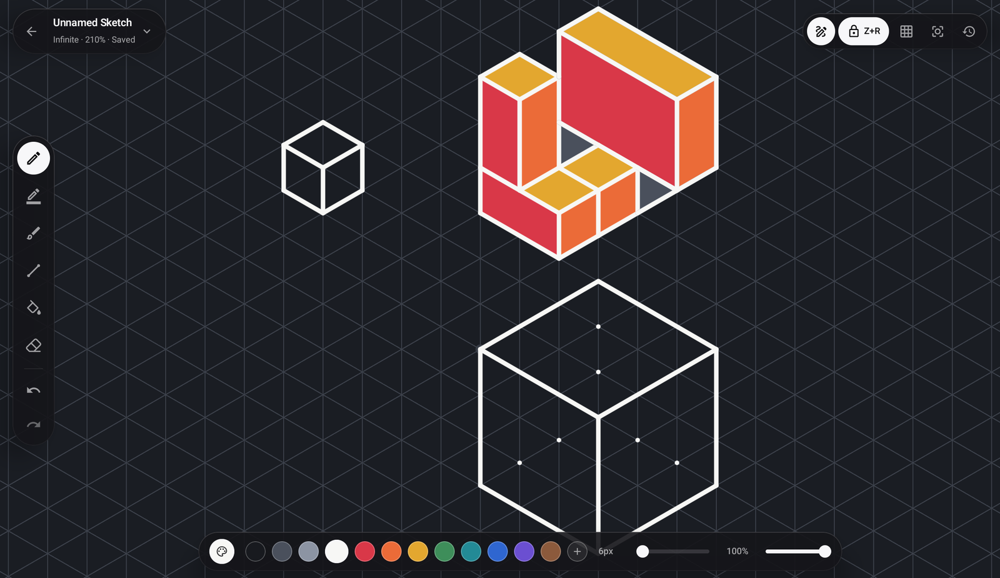
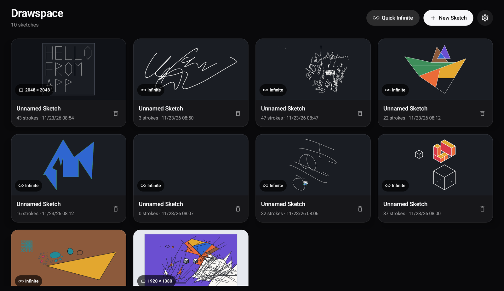
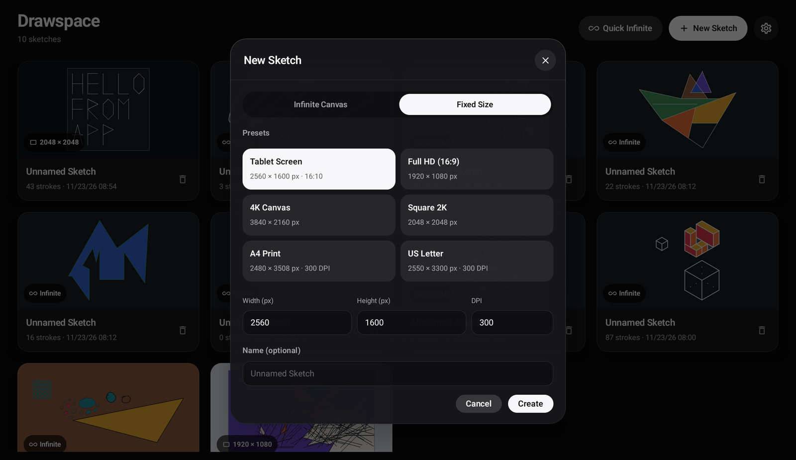
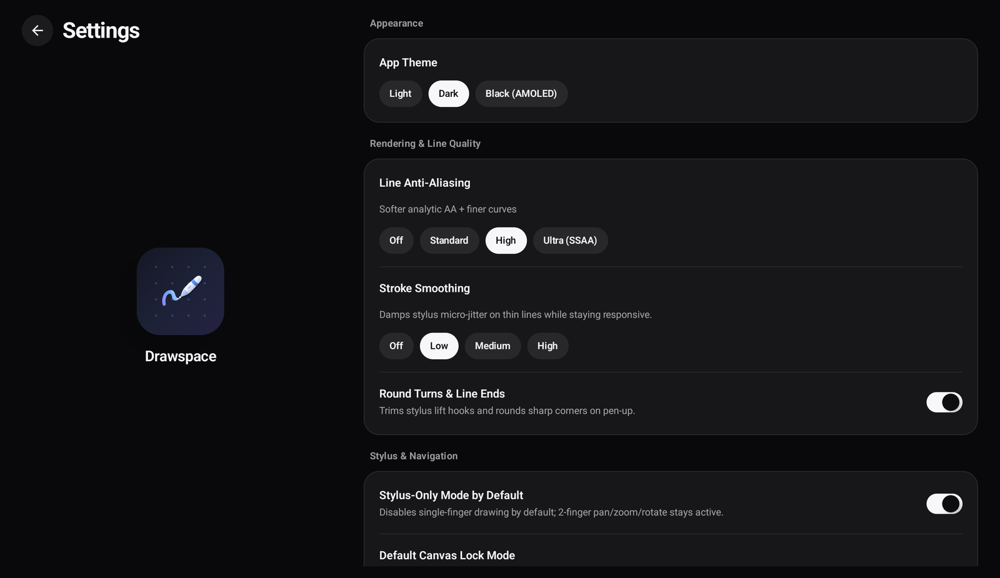

# Drawspace

[](https://github.com/McMelonTV/drawspace/actions/workflows/ci.yml)
[](https://github.com/McMelonTV/drawspace/releases/latest)
[](LICENSE)

Native Android tablet sketching app with low-latency stylus input (OpenGL ES 3.0 + Jetpack `GLFrontBufferedRenderer`) and an automatic bare-Git storage backend.



<table>
  <tr>
    <td></td>
    <td></td>
    <td></td>
  </tr>
  <tr>
    <td align="center">Workspace</td>
    <td align="center">Fixed-size presets</td>
    <td align="center">Settings</td>
  </tr>
</table>

## Install

Download the latest signed APK from [Releases](https://github.com/McMelonTV/drawspace/releases/latest) and install it on an Android 12+ (API 31) tablet. Drawspace is built for tablets with a stylus, but works with touch too.

## Features

- **Canvases:** Infinite canvas and fixed-size artboards (screen, square, 4K, A4/Letter @ 300 DPI, or custom).
- **Stylus & Input:** Pressure, tilt, orientation, motion prediction, palm rejection, optional stylus-only mode, 2-finger pan/zoom/rotate, and quick zoom/rotation lock toggle.
- **Tools:** Pen, Pencil, Marker, Straight Line (with grid-point and 15° angle snapping), Bucket Fill, and Eraser.
- **Color & Themes:** HSV color picker, customizable workspace palette, Light / Dark / AMOLED Black app themes, per-canvas theme overrides, and customizable background patterns (blank, dot grid, grid, lined, isometric, crosses).
- **Storage & History:** Crash-safe atomic WAL + bare JGit repository per workspace, persistent undo/redo across restarts, visual checkpoint history with diff previews, and auto-generated `preview.svg` + `README.md` files for browsing synced repos on GitHub.

## Modules

- `:app` — Jetpack Compose Material 3 tablet UI
- `:engine` — Pure-JVM document model, camera, undo/redo, stroke smoothing, bucket fill, grid snapping, and codecs
- `:renderer` — OpenGL ES 3.0 renderer, SDF anti-aliased ribbons, stylus input router, and PNG exporter
- `:storage` — Bare-plumbing JGit workspace store and atomic write-ahead log

## Build & Test

Requires JDK 17+ and Android SDK 36 (`minSdk = 31`).

```bash
# Run JVM unit tests (:engine and :storage)
./gradlew :engine:test :storage:test

# Build debug APK
./gradlew :app:assembleDebug

# Install on a connected tablet
adb install -r app/build/outputs/apk/debug/app-debug.apk
```

## Releasing

1. Bump `versionCode` and `versionName` in `app/build.gradle.kts`.
2. Optionally add release notes at `docs/release-notes/vX.Y.Z.md` (otherwise GitHub generates them).
3. Push a matching tag: `git tag vX.Y.Z && git push origin vX.Y.Z`.

The [Release workflow](.github/workflows/release.yml) runs the tests, builds a release APK signed with the key stored in the repository secrets, and publishes it with a `SHA256SUMS.txt`.

## License

Drawspace is free software, released under the [GNU General Public License v3.0](LICENSE).
